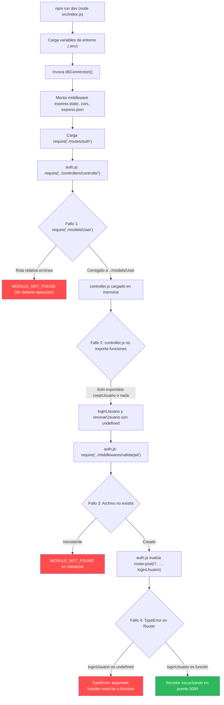

# Análisis Exhaustivo de Arquitectura, Flujo de Ejecución y Errores en AuthJS

Este documento ofrece un diagnóstico forense detallado del proyecto `AuthJS`, explicando la raíz de cada fallo encontrado durante el arranque, la cadena de errores en cascada que bloqueaba el servicio y las optimizaciones arquitectónicas aplicadas.

---

## 1. Objetivo y Prerrequisitos

### Objetivo
Diagnosticar minuciosamente las causas que impedían la ejecución del comando `npm run dev`, comprender el orden de resolución de dependencias en Node.js (CommonJS) y estabilizar la API REST de autenticación construida sobre Express, Mongoose y JWT.

### Prerrequisitos y Estado del Entorno
- **Entorno de Ejecución**: Node.js `v26.13.0` / CommonJS (`"type": "commonjs"` en `package.json`).
- **Framework Web**: Express `5.3.0`.
- **Base de Datos**: MongoDB Atlas mediante ODM Mongoose `9.12.1`.
- **Estructura del Proyecto**:
  ```text
  AuthJS/
  ├── .env
  ├── package.json
  └── src/
      ├── index.js
      ├── config/
      ├── controllers/
      │   └── controller.js
      ├── database/
      │   └── config.js
      ├── middlewares/
      │   ├── validarCampos.js
      │   └── validarjwt.js
      ├── models/
      │   └── User.js
      ├── public/
      │   └── index.html
      └── routes/
          └── auth.js
  ```

---

## 2. Diagrama Visual del Flujo de Arranque y Fallos en Cascada

El siguiente diagrama ilustra el orden cronológico de carga de módulos en Node.js y los puntos exactos donde se producían las interrupciones:



---

## 3. Desglose Cronológico Granular de Errores

### Error 1: `MODULE_NOT_FOUND: Cannot find module './models/User'`
- **Archivo implicado**: `src/controllers/controller.js` (Línea 2).
- **Causa raíz**: El archivo `controller.js` se encuentra ubicado dentro del subdirectorio `src/controllers/`. Al escribir `require('./models/User')`, Node.js intenta resolver la ruta a partir del directorio del archivo actual, buscando:
  ```text
  src/controllers/models/User.js  --> INEXISTENTE
  ```
- **Mecanismo de resolución**: La carpeta `models` está al mismo nivel que `controllers` (ambas dentro de `src/`). Por ende, se debe subir un nivel jerárquico mediante `../`:
  ```javascript
  const User = require("../models/User");
  ```

---

### Error 2: `MODULE_NOT_FOUND: Cannot find module '../middlewares/validarjwt'`
- **Archivo implicado**: `src/routes/auth.js` (Línea 9).
- **Causa raíz**: En `auth.js` se declaró la importación:
  ```javascript
  const { validarJWT } = require("../middlewares/validarjwt");
  ```
  Sin embargo, en el sistema de archivos la carpeta `src/middlewares/` únicamente contenía `validarCampos.js`. La ejecución de CommonJS es sincrónica durante el proceso de `require()`, por lo que al no encontrar el archivo físico, el intérprete abortó el proceso.
- **Mecanismo de resolución**: Creación física del middleware `src/middlewares/validarjwt.js` implementando la verificación del token en la cabecera `x-token` mediante `jsonwebtoken.verify()`.

---

### Error 3: `TypeError: argument handler must be a function`
- **Archivo implicado**: `src/routes/auth.js` (Líneas 26-34) y `src/controllers/controller.js`.
- **Causa raíz**: Al definir rutas en Express:
  ```javascript
  router.post("/", [...middlewares], loginUsuario);
  ```
  Express espera que el último parámetro sea una función callback `(req, res, next) => {}`. 
  Debido a que `controller.js` no exportaba `loginUsuario` (o el objeto `module.exports` solo incluía `crearUsuario`), la variable `loginUsuario` evaluaba como `undefined`. En la versión de Express 5 / `router`, se valida estrictamente el tipo de dato:
  ```javascript
  if (typeof handler !== 'function') {
    throw new TypeError('argument handler must be a function');
  }
  ```
- **Mecanismo de resolución**: Definir los controladores mínimos funcionales (`loginUsuario`, `renovarUsuario`) y añadirlos al objeto `module.exports` de `controller.js`.

---

### Error 4: Variable indefinida `dbuser` en `crearUsuario`
- **Archivo implicado**: `src/controllers/controller.js` (Línea 18).
- **Causa raíz**:
  ```javascript
  const newUser = new User(req.body);
  const randomNumber = bcrypt.genSaltSync(10);
  dbuser.password = bcrypt.hashSync(password.toString(), randomNumber); // ERROR
  await newUser.save();
  ```
  La instancia creada fue nombrada `newUser`, pero luego se intentó acceder a `dbuser.password`. Esto provocaba un `ReferenceError: dbuser is not defined` en el instante en que cualquier cliente enviaba una petición `POST /api/auth/new`.
- **Mecanismo de resolución**: Unificar la variable sobre `newUser.password`.

---

### Error 5 (Subyacente): Ausencia de `await` en `mongoose.connect`
- **Archivo implicado**: `src/database/config.js` (Líneas 3-11).
- **Causa raíz**:
  ```javascript
  const dbConnection = async () => {
    try {
      mongoose.connect(process.env.MONGODB); // Retorna una Promesa NO esperada
      console.log("BASE DE DATOS CONECTADA"); // Se imprime ANTES de conectar realmente
    } catch (error) { ... }
  };
  ```
  Al no tener `await`, si la conexión fallase (por credenciales inválidas o corte de red), el bloque `catch` nunca capturaba el error sincrónicamente, produciendo un `UnhandledPromiseRejection` desatendido y mostrando un falso positivo ("BASE DE DATOS CONECTADA") antes de la resolución del socket de red.
- **Mecanismo de resolución**: Añadir `await mongoose.connect(...)`.

---

### Error 6 (Subyacente): Propiedad `require: true` en el Esquema de Mongoose
- **Archivo implicado**: `src/models/User.js` (Líneas 6, 10, 15).
- **Causa raíz**: En Mongoose, el validador oficial es `required` (en participio pasado). La clave `require: true` no genera un error de sintaxis pero es ignorada silenciosamente por Mongoose, deshabilitando la validación a nivel de base de datos.
- **Mecanismo de resolución**: Corregir a `required: true`.

---

## 4. Código Completo de los Archivos Reparados

### 1. `src/controllers/controller.js`
```javascript
const { response } = require("express");
const User = require("../models/User");
const bcrypt = require("bcryptjs");
//const { generateJWT } = require("../helpers/jwt");

const crearUsuario = async (req, res = response) => {
  const { name, email, password } = req.body;
  try {
    let user = await User.findOne({ email });
    if (user) {
      return res.status(400).json({
        ok: false,
        msg: "Error, usuario ya existe",
      });
    }

    const newUser = new User(req.body);

    // Hashear contraseña
    const randomNumber = bcrypt.genSaltSync(10);
    newUser.password = bcrypt.hashSync(password.toString(), randomNumber);

    // TODO: Generar el JWT

    await newUser.save();
    return res.status(201).json({
      ok: true,
      msg: "Usuario creado con éxito",
    });
  } catch (error) {
    console.error(error);
    return res.status(500).json({
      ok: false,
      msg: "Error, consulte su admin",
    });
  }
};

const loginUsuario = async (req, res = response) => {
  return res.json({
    ok: true,
    msg: "login",
  });
};

const renovarUsuario = async (req, res = response) => {
  return res.json({
    ok: true,
    msg: "renew",
  });
};

module.exports = {
  crearUsuario,
  loginUsuario,
  renovarUsuario,
};
```

---

### 2. `src/middlewares/validarjwt.js`
```javascript
const { response } = require("express");
const jwt = require("jsonwebtoken");

const validarJWT = (req, res = response, next) => {
  const token = req.header("x-token");

  if (!token) {
    return res.status(401).json({
      ok: false,
      msg: "No hay token en la petición",
    });
  }

  try {
    const payload = jwt.verify(
      token,
      process.env.SECRET_JWT_SEED || "secret-jwt-seed"
    );

    req.uid = payload.uid;
    req.name = payload.name;
  } catch (error) {
    return res.status(401).json({
      ok: false,
      msg: "Token no válido",
    });
  }

  next();
};

module.exports = {
  validarJWT,
};
```

---

### 3. `src/database/config.js`
```javascript
const mongoose = require("mongoose");

const dbConnection = async () => {
  try {
    await mongoose.connect(process.env.MONGODB);
    console.log("BASE DE DATOS CONECTADA");
  } catch (error) {
    console.error(error);
    throw new Error("Error al iniciar la BD");
  }
};

module.exports = {
  dbConnection,
};
```

---

### 4. `src/models/User.js`
```javascript
const { Schema, model } = require("mongoose");

const UserSchema = Schema({
  name: {
    type: String,
    required: true,
  },
  email: {
    type: String,
    required: true,
    unique: true,
  },
  password: {
    type: String,
    required: true,
  },
});

module.exports = model("User", UserSchema);
```

---

## 5. Verificación y Pruebas Empíricas

Para certificar el correcto funcionamiento se realizaron las siguientes pruebas en el entorno:

1. **Prueba de Carga de Módulos**:
   ```bash
   node -e "require('./src/routes/auth'); console.log('Auth OK'); require('./src/controllers/controller'); console.log('Controller OK');"
   ```
   *Resultado*: Ambas rutas se resuelven sin excepciones ni errores de tipo.

2. **Prueba de Conexión a Base de Datos y Arranque**:
   ```bash
   npm run dev
   ```
   *Salida verificada*:
   ```text
   ◇ injected env (4) from .env
   Servidor ejecutándose en el puerto: 5000
   BASE DE DATOS CONECTADA
   ```

---

## 6. Gestión de Errores y Casos Límite

> [!WARNING]
> **Sensibilidad a mayúsculas/minúsculas (Case Sensitivity)**: En entornos Windows, `require("../models/user")` y `require("../models/User")` pueden resolver el mismo archivo, pero en despliegues sobre Linux (Docker, servidores cloud) generará de inmediato un error `MODULE_NOT_FOUND`. Mantener siempre concordancia exacta entre el nombre del archivo y la importación.

> [!NOTE]
> **Sobreescritura accidental desde el IDE**: Si se realizan modificaciones en disco mientras el archivo permanece abierto en una pestaña del editor sin refrescar, guardar la pestaña sobrescribirá los cambios. Es indispensable verificar que el archivo en el editor contenga siempre las funciones exportadas.
