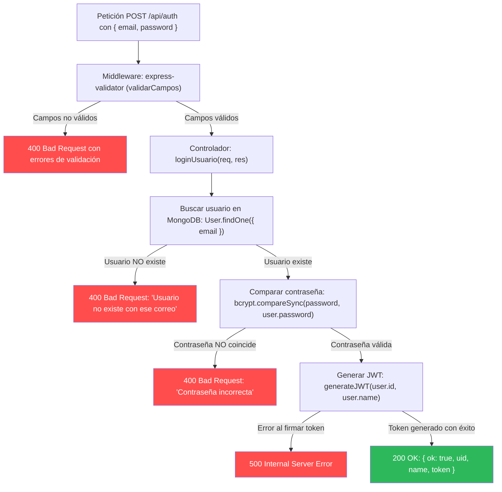

# Guía de Implementación Paso a Paso: Controlador de Login (`loginUsuario`)

Esta guía describe detalladamente la lógica, errores actuales y el procedimiento exacto para implementar de forma segura y robusta el inicio de sesión (`loginUsuario`) en el backend Express con MongoDB y JWT.

---

## 1. Objetivo y Prerrequisitos

### Objetivo
Transformar el controlador actual de `loginUsuario` para que autentique a un usuario existente verificando su correo electrónico y su contraseña encriptada (con `bcryptjs`), devolviendo un JSON Web Token (JWT) firmado para la sesión.

### Prerrequisitos
- Base de datos MongoDB conectada con la colección `users`.
- Modelo Mongoose en `src/models/User.js`.
- Paquetes `bcryptjs` y `jsonwebtoken` instalados en el proyecto.
- Variable de entorno `SECRET_JWT_SEED` (en `.env`) para la firma criptográfica de los tokens.

---

## 2. Diagrama Visual del Flujo de Autenticación (Login)



---

## 3. Desglose Granular de lo que Falla en tu Código Actual

Al revisar tu función actual:

```javascript
// TU CÓDIGO ACTUAL:
const loginUsuario = async (req, res = response) => {
  const { email, password } = req.body;
  try {
    const newUser = new User(req.body); // ❌ 1. Creando usuario en vez de buscarlo
    //Confirmamos si la contraseña coincide:
    const validPassword = bcrypt.compareSync(
      password.toString(),
      dbuser.password, // ❌ 2. dbuser no existe en la función
    );
    if (!validPassword) {
      return res.status(400).json({
        ok: false,
        msg: "El password mal",
      });
    }

    await newUser.save(); // ❌ 3. Guardando un usuario en el login
    return res.status(201).json({ // ❌ 4. Código 201 y mensaje de creación
      ok: true,
      msg: "Usuario creado con éxito",
    });
  } catch (error) { ... }
};
```

### Los 5 errores detectados:

1. **No buscas el usuario en la Base de Datos**:
   - En lugar de buscar al usuario registrado, tienes `const newUser = new User(req.body);`.
   - **Corrección**: Debes consultar MongoDB mediante `const user = await User.findOne({ email });`. Si `!user`, retornar un error `400`.

2. **Variable inexistente `dbuser`**:
   - En `bcrypt.compareSync(..., dbuser.password)`, la variable `dbuser` no está definida en ningún lado. Esto genera un `ReferenceError: dbuser is not defined` y envía la ejecución al `catch (error)`.
   - **Corrección**: Debe ser `user.password` (el hash que viene del usuario recuperado de la base de datos).

3. **Ejecutas `newUser.save()`**:
   - En el inicio de sesión **nunca** se ejecuta `.save()`. No estamos creando ni actualizando registros, solo verificando credenciales. Si se ejecutara `.save()`, intentaría crear un usuario duplicado o con password plano, rompiendo la base de datos por colisión de clave única de correo.

4. **Código de estado HTTP y respuesta incorrectos**:
   - Tienes `status(201)` (Created). El login exitoso debe ser `200` (OK).
   - El cliente que inicia sesión necesita recibir su identidad (`uid`, `name`) y su token JWT.

5. **Falta generar el JWT**:
   - Para que el usuario pueda autenticar peticiones posteriores (como en `/renew`), el servidor debe firmar y adjuntar un token en la respuesta.

---

## 4. Código y Bloques Completos para la Solución

### Paso 1: Crear el helper para generar JWT

Crear el archivo `src/helpers/jwt.js`:

```javascript
const jwt = require("jsonwebtoken");

const generarJWT = (uid, name) => {
  return new Promise((resolve, reject) => {
    const payload = { uid, name };

    jwt.sign(
      payload,
      process.env.SECRET_JWT_SEED || "palabra-secreta-por-defecto",
      {
        expiresIn: "2h",
      },
      (err, token) => {
        if (err) {
          console.error("Error al generar el JWT:", err);
          reject("No se pudo generar el token");
        }
        resolve(token);
      }
    );
  });
};

module.exports = {
  generarJWT,
};
```

---

### Paso 2: Implementar el `loginUsuario` correcto en `src/controllers/controller.js`

```javascript
const { response } = require("express");
const User = require("../models/User");
const bcrypt = require("bcryptjs");
const { generarJWT } = require("../helpers/jwt");

const loginUsuario = async (req, res = response) => {
  const { email, password } = req.body;

  try {
    // 1. Confirmar si el correo existe en la base de datos
    const user = await User.findOne({ email });

    if (!user) {
      return res.status(400).json({
        ok: false,
        msg: "El usuario no existe con ese correo electrónico",
      });
    }

    // 2. Confirmar si la contraseña coincide con el hash guardado
    const validPassword = bcrypt.compareSync(password.toString(), user.password);

    if (!validPassword) {
      return res.status(400).json({
        ok: false,
        msg: "Contraseña incorrecta",
      });
    }

    // 3. Generar el JWT para la sesión
    const token = await generarJWT(user.id, user.name);

    // 4. Respuesta exitosa con los datos del usuario y el token
    return res.status(200).json({
      ok: true,
      uid: user.id,
      name: user.name,
      token,
    });
  } catch (error) {
    console.error("Error en loginUsuario:", error);
    return res.status(500).json({
      ok: false,
      msg: "Por favor hable con el administrador",
    });
  }
};
```

---

## 5. Verificación y Pruebas Empíricas

### Prueba con cURL / Thunder Client / Postman

1. **Petición con credenciales correctas**:
   - **Método**: `POST`
   - **URL**: `http://localhost:5000/api/auth/`
   - **Body (JSON)**:
     ```json
     {
       "email": "test@correo.com",
       "password": "miPassword123"
     }
     ```
   - **Respuesta esperada (200 OK)**:
     ```json
     {
       "ok": true,
       "uid": "673752e2a39...",
       "name": "Edu",
       "token": "eyJhbGciOiJIUzI1NiIsInR5cCI6IkpXVCJ9..."
     }
     ```

2. **Petición con contraseña incorrecta**:
   - **Respuesta esperada (400 Bad Request)**:
     ```json
     {
       "ok": false,
       "msg": "Contraseña incorrecta"
     }
     ```

---

## 6. Alertas y Buenas Prácticas

> [!WARNING]
> **Seguridad en respuestas de Login**: En entornos de producción reales se recomienda unificar el mensaje de error tanto para usuario no existente como para contraseña errónea (por ejemplo: *"Credenciales inválidas"*), evitando que atacantes averigüen qué correos están registrados en el sistema.

> [!NOTE]
> **Asincronía de JWT**: La librería `jsonwebtoken` funciona de forma síncrona o por callbacks. Envolverla en una `Promise` (como en el helper `generarJWT`) permite usar `await` limpiamente dentro de los controladores `async`.
